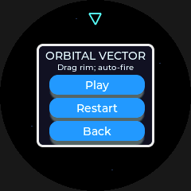
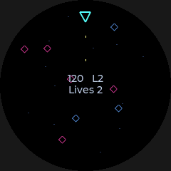

# Orbital Vector

An original vector-style orbital shooter inspired by Gyruss, designed for this
240×240 round touch display. It uses no arcade ROM, copied artwork or music.
Open **Apps → Games → Orbital Vector**, or use `orbit on` in the USB/WebUI console.
The opening panel explains the controls; tap **Play**.




- Drag around the rim to steer. The ship follows the shortest angular path.
- Firing is automatic. Shots travel inward while enemies spiral outward.
- Tap the centre to pause; choose **Resume**, **Restart** or **Back**.
- You start with three lives. Hits score ten points; each 100 points increases
  the level/speed, up to level 15. Enemy contact costs a life.
- Game over offers **Retry** and **Back**. `orbit off` returns to Apps.

The game pauses when the device lock overlay appears. It respects existing
lock/display settings. Score is session-only, and there is no audio output.
Keyboard/console joystick left/right provide coarse steering; select pauses
or resumes. The physical controls are designed around the touchscreen.

## Math and memory

The deterministic model occupies **168 bytes**, with fixed capacities of twelve
enemies, eight shots and four short hit bursts. It allocates no objects per shot,
frame or collision. The view creates its LVGL root/HUD/timer on entry and creates
and deletes a small panel for pause/game over. There is no game framebuffer or
animation task. The existing display buffers provide SPI DMA storage.

Radii use Q8 fixed point. Angles use 1,024 units per turn. Linear interpolation
of the existing 256-entry sine table gives Q15 sine/cosine values; bounded Q8×Q15
products fit signed 32 bits and shift directly to screen coordinates. A separate
65-byte arctangent octant table turns touch coordinates into a steering angle.
No `sin`, `cos`, `atan2`, floating-point arithmetic or square root is used by the
model. Angular/radial collision checks avoid Cartesian distance calculations.

Simulation advances in 16 ms steps and caps catch-up at 64 ms per timer pass.
That protects responsiveness after a scheduling delay, and pauses do not build
an unbounded backlog. Rendering uses clipped LVGL vector lines. Each moving
object invalidates the union of its old and new bounds. This keeps normal
updates within LVGL's invalidation capacity instead of overflowing it into a
full-screen repaint. Achieved display fps depends on scene density and SPI/UI
scheduling; a 16 ms timer does not guarantee 60 fps.

## Tests

The pure model test checks 150,000 deterministic steps, angle wrap and lookup
accuracy, object/radius bounds, hit scoring and player collisions. ASan/UBSan
checks pass. The native LVGL test runs twenty play, lock/pause, restart and back
cycles, and checks sparse steady-state pixel traffic.

```sh
cmake --build build/layout-tests --target orbital_model_test orbital_view_test
ctest --test-dir build/layout-tests --output-on-failure -R orbital
```

See [RISC_V_OPTIMISATION.md](RISC_V_OPTIMISATION.md) for compiler/assembly timing
results and [SCREENSAVER.md](SCREENSAVER.md) for Copper Dream and Neon Vortex.

The opening panel and live gameplay were captured from the device through the
USB display mirror. These are snapshots assembled from display tiles, not
frame-rate measurements. GhostESP's touch-move filter explicitly enables this
view so rim drags reach the model continuously.
