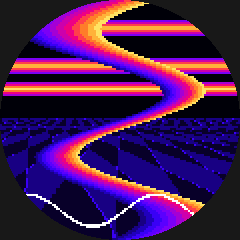

# Procedural round-screen demos

This ESP32-2424S012 build has two real-time effects for the round 240×240 panel:

- **Copper Dream**: an original Future Crew-inspired scene with a shaded sine
  twister, copper bars, perspective checker floor, stars and moving sine trace.
  Open **Apps → Media → Copper Dream** or run `saver crew`.
- **Neon Vortex**: plasma/rings/checker rotozoom. Open **Apps → Media → Neon Vortex**
  or run `saver neon`.

Touch dismisses the effect. The waking press, drag and release are consumed so
that they cannot activate an option underneath. The previous screen stays alive.

| Command | Action |
|---|---|
| `saver on` | Start the selected effect over the current unlocked, illuminated screen |
| `saver crew` / `saver neon` | Select and start an effect |
| `saver off` | Stop and disable automatic activation for this boot |
| `saver auto` | Enable automatic activation after 15 seconds idle on the main menu |
| `saver status` | Active/automatic state, effect, frame count, elapsed time, render fps and raster timing |
| `saver bench crew` / `saver bench neon` | Time 32 software-raster frames; does not change the screen |
| `saver kernels` | Compare checked C/ASM palette-expansion kernels |

Automatic mode starts enabled with Copper Dream selected. It only runs on the
main menu, and Reduced Motion suppresses automatic activation. Explicit launch
still works with Reduced Motion. Locking, dimming, switching views or turning
the backlight off stops the effect. It does not unlock the device, change the
display timeout or keep the screen awake. With the default 30-second timeout,
it can run between 15 seconds idle and dimming at 30 seconds. Saver preferences
are not written to NVS. Launch while locked/dimmed selects an effect but does
not queue a delayed manual start; normal automatic rules still apply later.



[Animated Copper Dream reference](docs/copper-dream.gif) ·
[Animated Neon Vortex reference](docs/neon-vortex.gif).
These are host-generated at a nominal 20 fps using the actual C kernels. They
illustrate motion, not measured LCD frame rate. Preview files stay on the
computer and are not linked into the firmware.

```sh
python3 render_demo.py --effect crew --gif
python3 render_demo.py --effect neon --gif
```

## Technique and budget

Both scenes use fixed-point/integer arithmetic, a shared flash sine table,
globally anchored 2×2 sampling and wall-clock phase. Late frames skip ahead
rather than building a catch-up backlog. They write directly into LVGL's
existing draw buffer, without a canvas, full image, animation task or extra
animation timer. The existing UI task drives the overlay from its timer pass.

Copper Dream calculates 120 logical pixels per row, packs them into **60 bytes**,
and uses a **32-byte working RGB565 palette** on the stack. A C kernel expands
the nibbles into doubled horizontal pixels; duplicate vertical rows are copied
where a strip contains both. The measured C expander is 122 bytes in IRAM.
Two reciprocal calculations happen per generated row, rather than per pixel.
The profiler reported 208 stack bytes for the complete `-O3` raster function,
including scratch and compiler spills, before final call-site changes.
Neon Vortex's pure raster has zero static writable data and 768 bytes of flash
tables. No 115,200-byte RGB565 framebuffer or 28,800-byte indexed image is stored.

The controller has about 54 bytes of static state before alignment, plus one
LVGL object/styles/event allocation on activation. Those are freed on exit.
The raster callback performs no heap allocation. Infrastructure and the previous
screen retain their memory; the state count is not the total UI cost.

The board now has **two five-line RGB565 DMA buffers: 4,800 bytes total**. This
adds 2,400 bytes to the earlier single-buffer build, with a single-buffer fallback
on allocation failure. A completion semaphore yields the CPU during DMA waits.
Palette packing saves scratch/asset memory; the LCD still receives RGB565.

The frame request period is 50 ms, a target ceiling of 20 fps. A full square's
pixels alone take 46.08 ms over 20 MHz SPI. Commands, LVGL and scheduling add time.
Invisible corners are still transferred. Panel/flash clocks remain unchanged.
`saver status` counts renders reaching the bottom-right and sums raster time;
it does not measure panel scanout or touch latency. Keep mirroring off for timing.
A brief `saver bench` allocation is 2,400 bytes and is freed afterward; its times
include one-tick yields but exclude LCD transfers. It also works while locked.

The prior single-buffer Neon build observed 7.7 rendered fps, despite a roughly
7 ms raster. The new scene/compiler/kernel and buffer results are recorded in
[RISC_V_OPTIMISATION.md](RISC_V_OPTIMISATION.md) and
[BINARY_OPTIMISATION.md](BINARY_OPTIMISATION.md); do not substitute the 20 fps target
or host GIF rate for measured device performance.

## Verification

Raster tests compare full frames with five-line/odd clipped strips, byte order,
canaries, phases and rollover. Packed expansion checks every input byte and
aligned/unaligned buffers. Native LVGL tests verify actual flushed pixels and
repeat 100 start/wake/view/lock/off cycles. A delayed completion test checks
that ping-pong rendering does not overwrite a buffer still owned by DMA.
ASan/UBSan checks pass on the pure kernels. Hardware tests remain distinct from
host tests; these changes do not prove that the historical BadBLE freeze is gone.

A short combined-build Copper Dream device sample measured **8.8 fps**
(19 frames / 2,145 ms), with a 6,789 µs average raster time. This is an observed
sample after mixed radio/navigation activity, not a sustained guarantee or a
controlled comparison against Neon Vortex. The complete refresh cycle remains
considerably slower than the raster calculation.
